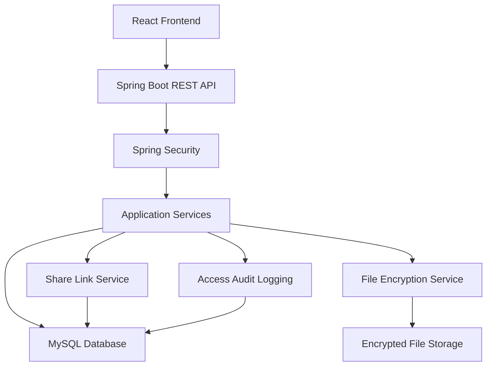

# 🔐 Vaultline — Secure File-Sharing Platform

**Share securely. Protect by design.**

Vaultline is a security-focused file-sharing platform designed to protect sensitive files through encryption, controlled access, and secure sharing mechanisms.

Built with Java 17, Spring Boot, Spring Security, and MySQL, Vaultline allows registered users to upload files, store them in encrypted form, and share them through secure links with configurable expiration times, download limits, and optional password protection.

The project focuses on combining backend engineering with practical cybersecurity principles, including cryptographic protection, access control, secure token generation, abuse prevention, and security auditing.

> **Project Status:** Work in Progress — Development is guided by a security-first specification. Features will be marked as implemented and tested as development progresses.

## 🎯 Project Objective

The goal of Vaultline is to explore how secure software engineering principles can be applied to a real-world file-sharing application.

Rather than treating security as an afterthought, the project incorporates security requirements into the application architecture, API design, data model, and testing strategy.

The project also includes a hands-on security testing process in which the application is deliberately tested against common attacks to identify vulnerabilities and verify implemented defenses.

## ✨ Key Features

### Secure File Management
- Upload and download files securely.
- Encrypt files before persistent storage using AES-256-GCM.
- Store files using randomly generated UUID-based filenames.
- Restrict file uploads by size and allowed file types.
- Allow users to list, download, and delete their own files.

### Secure File Sharing
- Generate cryptographically secure sharing tokens.
- Create links with configurable expiration times.
- Restrict links using download limits, including one-time access.
- Support optional password-protected sharing.
- Revoke sharing links at any time.
- Store only SHA-256 hashes of sharing tokens in the database.

### Authentication and Authorization
- User registration and login.
- BCrypt password hashing.
- JWT-based authentication.
- Role-based access control using Spring Security.
- Account lockout after repeated failed login attempts.
- Resource ownership validation to prevent unauthorized access.

### Security Monitoring
- Log file-sharing access attempts.
- Record successful and unsuccessful access events.
- Track relevant security events, timestamps, and request metadata.
- Provide access history to file owners.
- Allow administrators to review security logs and manage user accounts without accessing file contents.

### Abuse Prevention
- Rate limiting for login and sharing-link access.
- Protection against password guessing and token enumeration.
- Consistent error responses for invalid, expired, and revoked links.
- Atomic download-counter updates to prevent concurrent reuse of one-time links.

## 🛠️ Tech Stack

| Component | Technology |
|---|---|
| Backend | Java 17 |
| Framework | Spring Boot 3 |
| Security | Spring Security, JWT |
| Cryptography | AES-256-GCM, SHA-256, BCrypt, SecureRandom |
| Database | MySQL 8 |
| ORM | Spring Data JPA, Hibernate |
| Frontend | React |
| Containerization | Docker, Docker Compose |
| Testing | JUnit 5, Mockito |

## 🏗️ System Architecture

Vaultline follows a layered application architecture that separates the frontend, backend services, security controls, database, and encrypted file storage.



### Core Components

- **Authentication Service:** Handles registration, login, password hashing, JWT generation, and account lockout.
- **File Service:** Manages file uploads, downloads, ownership validation, and deletion.
- **Encryption Service:** Encrypts and decrypts files using AES-256-GCM.
- **Sharing Service:** Generates secure tokens and enforces expiration, download limits, password protection, and revocation.
- **Audit Service:** Records file access attempts and security-related events.
- **Authorization Layer:** Ensures users can access only the resources they are permitted to access.

## 🔒 Security Design

Security is a core design consideration in Vaultline.

### File Encryption

Files are encrypted before being written to persistent storage using AES-256-GCM.

Each file uses a fresh random initialization vector (IV), and the encryption key is supplied through an environment variable rather than being hardcoded into the application.

A production deployment would use a managed key service such as AWS KMS and per-file data encryption keys.

### Secure Sharing Tokens

Sharing links use 32 cryptographically secure random bytes generated through Java's `SecureRandom`.

Only the SHA-256 hash of the token is stored in the database. The original token is returned to the user when the link is created.

This reduces the risk of usable sharing links being exposed through a database compromise.

### One-Time Access

Download limits are enforced through an atomic database update.

This is designed to prevent multiple simultaneous requests from successfully consuming the same one-time link.

### Access Control

Vaultline uses Spring Security and role-based access control.

Users can manage only their own files and sharing links. Unauthorized file ownership requests return a `404 Not Found` response to reduce resource enumeration.

Administrators can review access logs and manage accounts but cannot read file contents.

### Security Testing

Vaultline includes a manual attack checklist and automated tests covering:

- Repeated password guessing.
- Sharing-token guessing and enumeration.
- Unauthorized file access.
- Malicious filenames and path traversal attempts.
- Oversized and disallowed file uploads.
- Concurrent reuse of one-time links.
- Direct access to encrypted files on disk.
- Database exposure of password hashes and sharing tokens.

Security testing results will be documented as development progresses.

## 📋 API Overview

The planned REST API includes the following endpoints:

| Method | Endpoint | Purpose |
|---|---|---|
| POST | `/api/auth/register` | Register a user |
| POST | `/api/auth/login` | Authenticate and obtain a JWT |
| POST | `/api/files` | Upload a file |
| GET | `/api/files` | List owned files |
| GET | `/api/files/{id}` | Download an owned file |
| DELETE | `/api/files/{id}` | Delete a file and its sharing links |
| POST | `/api/files/{id}/links` | Create a sharing link |
| DELETE | `/api/links/{id}` | Revoke a sharing link |
| GET | `/api/links/{id}/log` | View access history |
| GET | `/s/{token}` | Download a file through a sharing link |
| GET | `/api/admin/log` | View administrative access logs |

## 🚀 Getting Started

### Prerequisites

- Java 17
- Maven
- MySQL 8
- Docker and Docker Compose
- Node.js and npm (for the React frontend)

### Installation

Clone the repository:

```bash
git clone https://github.com/YOUR_USERNAME/Vaultline.git
cd Vaultline
```

Configure the application environment:

```env
DB_URL=jdbc:mysql://localhost:3306/vaultline
DB_USERNAME=vaultline_user
DB_PASSWORD=your_database_password
JWT_SECRET=your_jwt_secret
FILE_ENCRYPTION_KEY=your_base64_encoded_32_byte_key
```

> Never commit actual credentials, JWT secrets, encryption keys, or production configuration files to GitHub.

Build the backend:

```bash
./mvnw clean package
```

Start the application:

```bash
./mvnw spring-boot:run
```

The exact setup and Docker Compose instructions will be updated as the implementation progresses.

## 🧪 Testing

Vaultline uses JUnit 5 and Mockito for automated testing.

Planned test coverage includes:

- Password hashing and account lockout.
- Sharing-token generation and uniqueness.
- File encryption and decryption.
- Link expiration and download-limit enforcement.
- Authorization and resource ownership.
- Concurrent one-time download requests.

Manual security testing will be documented separately, including the attacks attempted, observed results, and fixes applied.

## 🗺️ Development Roadmap

- [ ] User registration and authentication.
- [ ] JWT authentication and account lockout.
- [ ] Encrypted file upload and download.
- [ ] Secure file-sharing links.
- [ ] Expiration, download limits, and revocation.
- [ ] Optional password-protected links.
- [ ] Role-based access control.
- [ ] Access logging and administrative functionality.
- [ ] Rate limiting and abuse prevention.
- [ ] React frontend.
- [ ] Automated security tests.
- [ ] Docker Compose setup.
- [ ] Security attack checklist and documentation.

## 📄 Project Specification

The detailed technical specification, including design decisions, data models, API contracts, security requirements, edge cases, and test plans, is available in [`SPEC.md`](./SPEC.md).

The specification is maintained alongside the implementation and updated whenever a significant design decision changes.

## 🔮 Future Enhancements

- AWS S3 integration for cloud-based encrypted storage.
- AWS KMS integration for managed encryption keys.
- Malware scanning for uploaded files.
- Security event monitoring and alerting.
- Advanced sharing policies and access controls.
- Integration with a home security monitoring lab.

## 👨‍💻 Siri Bandaru

Developed as a hands-on project to explore the intersection of Java backend engineering and cybersecurity.

**Vaultline — Share securely. Protect by design.**
